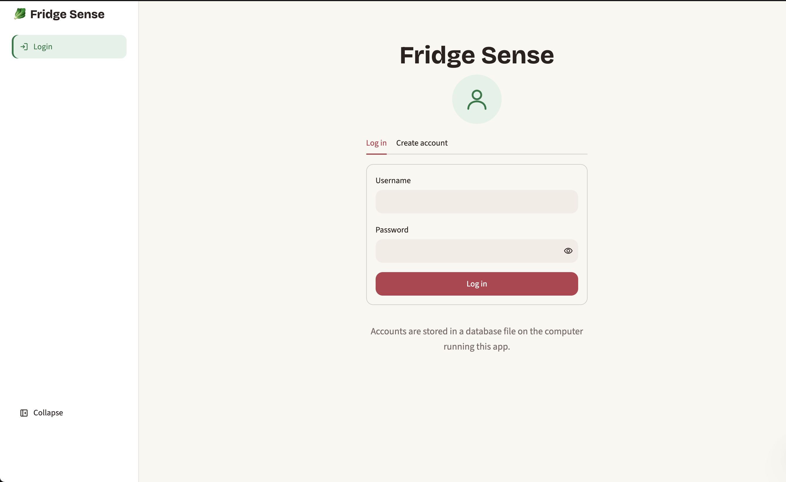
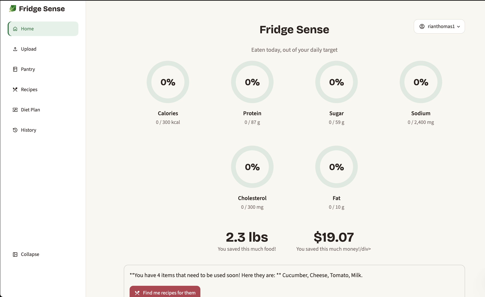
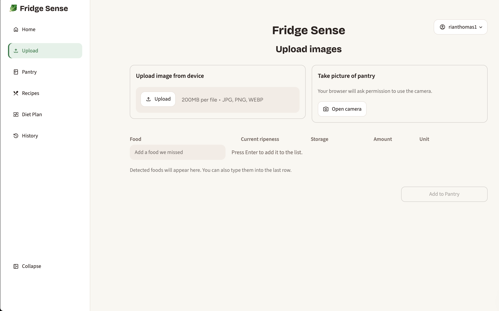
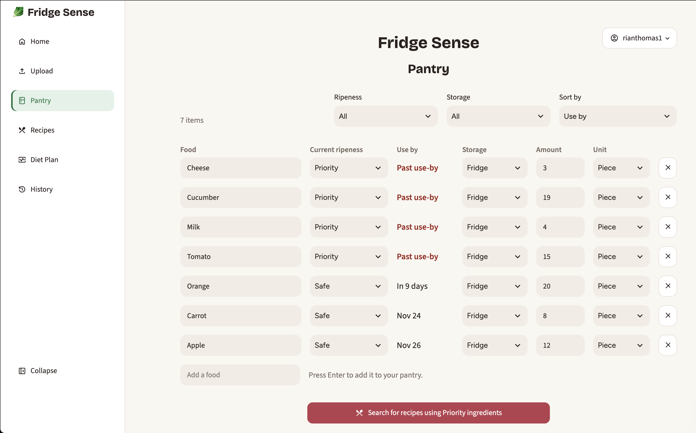
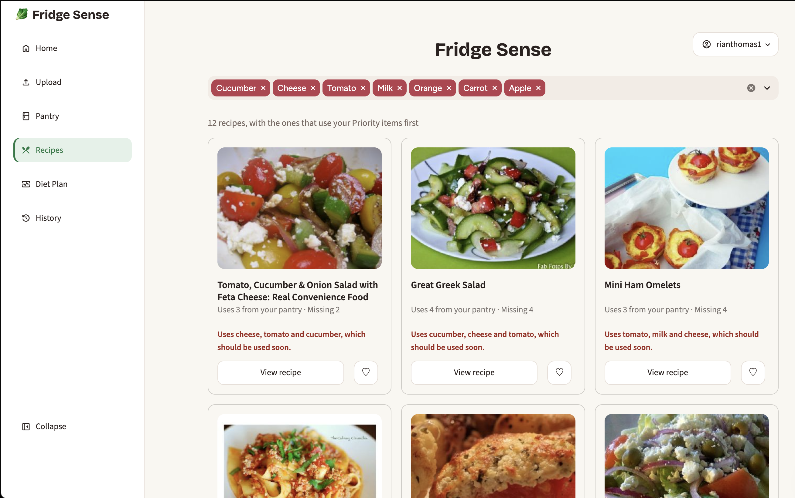
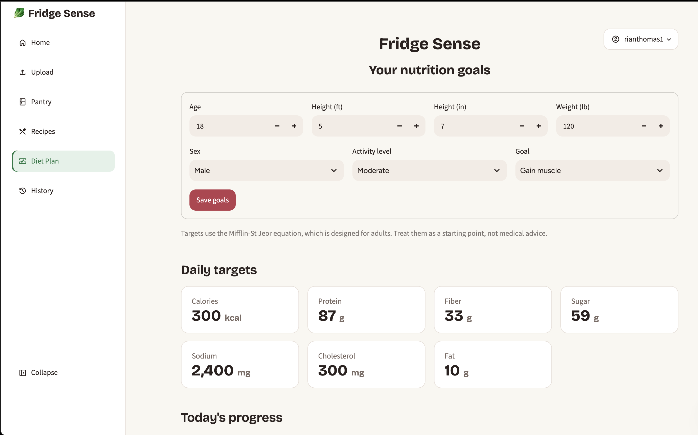
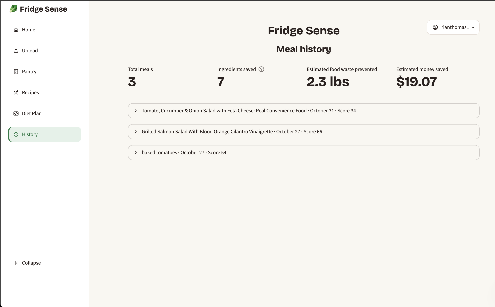

# FridgeSense

### An AI-powered food inventory and food-waste reduction application

FridgeSense is a food-management application built with Python and Streamlit. It combines computer vision, artificial intelligence, and recipe recommendations to help users organize their food inventory, monitor freshness, and make better use of ingredients they already own.

Users can upload photos of their pantry or take pictures directly through the application. A trained YOLO object-detection model identifies food items, which can then be added to an editable inventory. FridgeSense tracks estimated shelf life, prioritizes ingredients that should be used soon, and recommends recipes based on available ingredients.

The application also includes nutritional information, meal scoring, personalized nutrition targets, and food-waste tracking.

---

## Features

- **AI Food Detection:** Uses a trained YOLO model to recognize food items from uploaded images.
- **Camera Integration:** Allows users to take pictures of their pantry directly through the application.
- **Food Inventory Management:** Stores food names, quantities, storage locations, and estimated use-by dates.
- **Freshness Prioritization:** Categorizes food as Priority, Moderate, or Safe based on its estimated use-by date.
- **Recipe Recommendations:** Finds recipes using ingredients already available in the user's pantry.
- **AI-Generated Explanations:** Uses Google's Gemini API to explain meal scores and nutritional information.
- **Nutritional Analysis:** Displays calories, protein, fiber, sugar, sodium, cholesterol, fat, and carbohydrates.
- **Meal Scoring:** Evaluates recipes against daily nutrition targets using a scoring system.
- **Meal History:** Records cooked meals, ingredients used, and estimated food and money savings.
- **User Accounts:** Supports account creation, login, and separate user data.

---

## Application Pages

### 1. Login Page

The Login page is the entry point to FridgeSense. Users can either sign in to an existing account or create a new one.

Key functionality:
- Allows users to register with a username and password.
- Provides account login and authentication.
- Validates usernames and passwords.
- Uses salted password hashing rather than storing passwords directly.
- Keeps each user's pantry, nutrition profile, saved recipes, and meal history separate.

**Screenshot:**

`images/login.png`



### 2. Home Dashboard

The Home page provides an overview of the user's nutrition progress and food-saving impact.

Key functionality:
- Displays six visual nutrition rings for calories, protein, sugar, sodium, cholesterol, and fat.
- Compares daily nutrition totals against calculated targets.
- Tracks estimated food saved and money saved.
- Provides contextual recommendations based on the user's pantry.
- Directs users to relevant actions, such as uploading food or finding recipes for ingredients that need to be used soon.

**Screenshot:**

`images/home.png`



### 3. Upload Page

The Upload page connects computer vision with the food inventory system. Users can submit a picture of their pantry or take a new picture using their device's camera.

Key functionality:
- Supports JPG, JPEG, PNG, and WebP image uploads.
- Provides direct camera capture through the browser.
- Processes images using a trained YOLO object-detection model.
- Identifies recognized food items and counts detected objects.
- Displays detected items in an editable table.
- Allows users to add foods that the model missed.
- Lets users adjust quantities, storage locations, and freshness classifications before saving.
- Transfers confirmed items into the Pantry page.

**Screenshot:**

`images/upload.png`



### 4. Pantry Page

The Pantry page serves as the user's editable food inventory. It organizes recognized and manually entered food items while tracking their estimated freshness.

Key functionality:
- Displays food names, quantities, units, storage locations, freshness levels, and use-by dates.
- Allows users to edit existing food items.
- Supports adding and deleting inventory items.
- Provides filters for freshness and storage location.
- Allows sorting by use-by date, name, or quantity.
- Automatically updates freshness classifications as use-by dates approach.
- Identifies Priority ingredients that should be used soon.
- Provides a shortcut to find recipes using those ingredients.

**Screenshot:**

`images/pantry.png`



### 5. Recipes Page

The Recipes page helps users find meals based on the ingredients they already have. It connects the pantry inventory with recipe information and nutritional analysis.

Key functionality:
- Searches for recipes using selected pantry ingredients.
- Uses the Spoonacular API to retrieve recipe recommendations when configured.
- Prioritizes recipes that use ingredients classified as Priority.
- Displays the ingredients available in the pantry and those that are missing.
- Provides recipe details, cooking instructions, preparation time, and serving information.
- Displays nutritional information for each recipe.
- Calculates a meal score based on nutritional targets.
- Uses Gemini to generate explanations of meal scores when configured.
- Allows users to save recipes for later.
- Includes a Cook This Meal feature that deducts matched ingredients from the pantry and records the meal.

**Screenshot:**

`images/recipes.png`



### 6. Diet Plan Page

The Diet Plan page allows users to create a nutrition profile and view calculated daily nutrition targets.

Key functionality:
- Collects profile information, including age, height, weight, and activity level.
- Allows users to select a nutrition goal.
- Calculates daily nutrition targets using the Mifflin-St Jeor equation and activity multipliers.
- Displays targets for calories, protein, fiber, sugar, sodium, cholesterol, and fat.
- Tracks daily progress toward those targets.
- Displays meals recorded during the current day.

The targets are intended as estimates rather than medical advice.

**Screenshot:**

`images/diet_plan.png`



### 7. History Page

The History page records previously cooked meals and summarizes the application's estimated food-saving impact.

Key functionality:
- Displays the total number of meals recorded.
- Tracks ingredients saved by using food classified as Priority or Moderate.
- Estimates the amount of food waste prevented.
- Estimates money saved.
- Stores individual meal records with cooking dates and meal scores.
- Displays ingredients taken from the pantry for each meal.
- Shows nutritional information for previously cooked recipes.

**Screenshot:**

`images/history.png`



---

## How FridgeSense Works

FridgeSense connects food recognition, inventory management, and recipe recommendations into one workflow.

1. **Capture:** The user uploads a pantry image or takes a picture using the camera.
2. **Recognition:** The YOLO model identifies food items in the image.
3. **Inventory:** Detected foods are reviewed and added to the user's pantry.
4. **Freshness Tracking:** The application estimates shelf life and assigns freshness classifications based on use-by dates.
5. **Recipe Search:** Pantry ingredients are used to find relevant recipes through Spoonacular or the application's sample recipe data.
6. **Nutrition Analysis:** Recipe nutrition is compared against the user's calculated daily targets.
7. **Meal Tracking:** When a user cooks a recipe, matched ingredients are deducted from the pantry and the meal is recorded.
8. **Impact Tracking:** The application updates its estimated food-saving and money-saving statistics.

---

## Technology Stack

| Technology | Purpose |
|---|---|
| Python | Main application language |
| Streamlit | Web application interface |
| YOLO / Ultralytics | Food object detection |
| Roboflow | Dataset access for model training |
| Google Gemini API | AI-generated meal score explanations |
| Spoonacular API | Recipe search, details, and nutritional information |
| SQLite | User accounts, pantry inventory, saved recipes, and meal history |
| Pandas / Python data processing | Supporting data operations |

---

## Project Structure

```text
FridgeSense/
│
├── app.py
├── ai.py
├── model.py
├── scoring.py
│
├── core/
│   ├── auth.py
│   ├── db.py
│   ├── demo.py
│   ├── matching.py
│   ├── services.py
│   ├── shelf_life.py
│   ├── stats.py
│   └── units.py
│
├── ui/
│   ├── common.py
│   ├── diet_plan.py
│   ├── history.py
│   ├── home.py
│   ├── login.py
│   ├── pantry.py
│   ├── recipes_page.py
│   ├── theme.py
│   └── upload.py
│
├── recipe/
│   └── recipes.py
│
├── nutrition/
│   └── nutrients.py
│
├── model/
│   └── best.pt
│
├── data/
│   └── shelf_life.csv
│
├── images/
│   ├── login.png
│   ├── home.png
│   ├── upload.png
│   ├── pantry.png
│   ├── recipes.png
│   ├── diet_plan.png
│   └── history.png
│
└── requirements.txt
```

*The structure above highlights the main application modules; optional data files and trained model weights may not be present in every installation.*

---

## Installation and Setup

### 1. Clone the repository

```bash
git clone https://github.com/RianThomas/FridgeSense.git
cd FridgeSense
```

### 2. Create a virtual environment

```bash
python -m venv .venv
```

Activate it:

**Mac/Linux**
```bash
source .venv/bin/activate
```

**Windows**
```bash
.venv\Scripts\activate
```

### 3. Install dependencies

```bash
pip install -r requirements.txt
```

For live food detection, install Ultralytics and provide the trained model weights:

```bash
pip install ultralytics
```

Place the trained `best.pt` file inside the `model/` directory.

### 4. Configure API keys

Create a `.env` file in the project root:

```env
GEMINI_API=your_gemini_api_key
SPOON_API=your_spoonacular_api_key
```

For optional Roboflow dataset access and model training, configure:

```env
ROBOFLOW_API_KEY=your_roboflow_api_key
```

Never commit API keys or other private credentials to GitHub.

### 5. Run FridgeSense

```bash
streamlit run app.py
```

The application will open in your browser.

---

## Sample Data and Fallback Functionality

FridgeSense includes sample data so users can explore parts of the application without configuring every external service.

When live integrations are unavailable:
- Sample food detections can be displayed.
- Example recipes can be searched.
- Sample recipe details and nutrition information can be shown.
- The application indicates which features are currently using sample data.

This allows users to explore the application while configuring their own API keys and model weights.

---
## Development Process and Contributions

FridgeSense was developed with a focus on building the application's backend systems and connecting multiple technologies into one functional platform.

### Backend Development

I independently designed and implemented the backend functionality that powers FridgeSense, including:

- **Database Management:** Built the data-management systems for user accounts, pantry inventory, saved recipes, and meal history.
- **Computer Vision Integration:** Integrated a trained YOLO object-detection model to identify food items from uploaded images and camera captures.
- **Inventory Management:** Developed the logic for tracking food quantities, storage locations, estimated shelf life, and freshness classifications.
- **Recipe Integration:** Connected the Spoonacular API to retrieve recipes, ingredients, cooking instructions, and nutritional information.
- **Nutrition and Scoring:** Implemented the nutritional calculations, daily target generation, and custom meal-scoring algorithm.
- **Food-Waste Tracking:** Developed the logic for deducting ingredients when meals are cooked and estimating food and money saved.
- **API and Service Integration:** Connected external services, handled API responses, and implemented fallback functionality when integrations are unavailable.

### Use of AI During Development

AI tools were used as development assistance throughout the project, primarily in three areas:

- **User Interface Development:** Assisted with designing and refining the Streamlit interface, including page layouts, visual styling, navigation, and presentation of information.
- **Code Troubleshooting:** Helped identify errors, understand unexpected behavior, debug integration issues, and explore possible solutions during development.
- **Documentation:** Assisted in organizing and writing the README, including explanations of the application's features, technologies, and setup instructions.

AI was used as a development tool rather than a replacement for implementing the application's core functionality. I designed, built, integrated, and tested the backend systems that make FridgeSense operate.

## Author

**Rian Thomas**

GitHub: [RianThomas](https://github.com/RianThomas)

Project Repository: [FridgeSense](https://github.com/RianThomas/FridgeSense)
